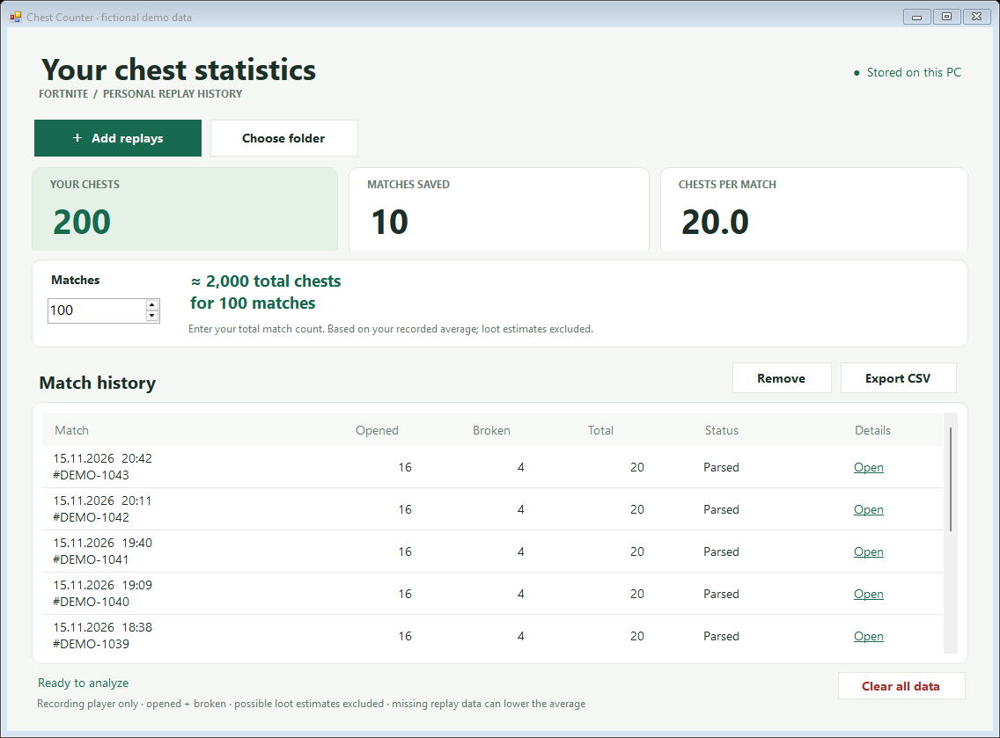

# Fortnite Chest Counter

A small, offline Windows app that counts your opened and broken chests from completed Fortnite replay files, calculates your average per match, and estimates your total chests for an entered total match count.



Screenshots use fictional demo data. No real player statistics or recordings are included.

[Personal match details](docs/match-details.png) · [Clear-data confirmation](docs/clear-data.png)

## Features

- Import individual `.replay` files, select a folder, or drag files into the window.
- View your chest total, saved-match count, and average chests per match.
- Enter your total number of **Matches** to see the estimated total chests for that many matches.
- Click **Open** to inspect your own counts, match date, match ID, and recorded events.
- Save personal statistics locally, skip duplicate imports, and export your match history to CSV.
- If files come from several recording accounts, an account selector keeps their histories and averages separate.
- Restore the previous statistics file from backup if the current one is damaged.
- **Clear all data** requires typing exactly `DELETE`. It clears saved statistics and application backups while preserving Fortnite replay files.

## Run

Requires Windows 10/11 x64 with .NET Framework 4.8. No administrator privileges, Python, or Rust are needed to run a built release.

1. Open this repository's **Releases** section and download **FortniteChestCounter.zip**.
2. Extract the entire ZIP into a writable folder, then open **ChestCounter.exe** (or **Start.cmd**).
3. Click **Add replays** or **Choose folder** and select completed recordings.

The portable ZIP already includes both compiled executables. GitHub's **Code → Download ZIP**, the automatic **Source code** downloads, and `FortniteChestCounter-source.zip` contain source code and require a build instead.

Fortnite's usual replay folder is:

```text
%LOCALAPPDATA%\FortniteGame\Saved\Demos
```

Keep `ChestCounter.exe`, its `.config` file, and `bin/replay-analyzer.exe` together. Close the app before replacing it with an updated build.

## How counts work

The parser reads recorded object state, including `bAlreadySearched` and `SearchingPawn`, and saves events belonging to the recording player only. An opened chest is not counted again when subsequently destroyed. The teammate feature has been removed from the application and parser output.

Possible additional chests inferred from loot are shown separately and excluded from totals, averages, and projections. **Parsed** means the network packets were read successfully; it does not guarantee that every chest event was recorded. **Partial** identifies decoding problems or a game version outside the versions recognized by this build.

Destroying a chest's supporting floor is counted only if the replay attributes the resulting chest destruction to that player. This specific case still requires an in-game control test. Repeated loot refills of the same chest object also need separate validation.

Existing personal statistics remain readable without re-importing recordings. Legacy team fields are ignored when loading and omitted the next time statistics are saved. Your own match counts are preserved.

## Average and projection

The average is your recorded **opened + broken** total divided by the number of saved matches for the selected recording account. Zero-chest matches are included.

- Estimated total chests = average × entered total matches.
- The entered number is the full match count. Saved matches and chests are not added again.
- Only the final predicted chest count is rounded; the displayed average is not used as an intermediate rounded value.

For example, 200 chests in 10 saved matches gives an average of 20. Entering 15 in **Matches** estimates approximately 300 chests in total. Entering 10 estimates 200; entering 0 estimates 0.

The forecast describes what would happen at your recorded historical average. It is not a guarantee. Missing replay events can lower that average. An empty history shows no invented average or forecast.

Folder scans are safe to repeat after restarting the app. Previously imported file contents are recognized by SHA-256, including renamed copies. A second identity check uses the match and recording-player IDs, so another recording of the same match updates its existing entry instead of adding a duplicate. A scan containing only duplicates does not rewrite the statistics file.

## Local data and privacy

The app reads selected replay files and writes `data/statistics.json` next to the executable. The previous version is kept as `data/statistics.json.bak`. To transfer or back up your history, copy the `data` folder while the app is closed. Confirmed **Clear all data** replaces the saved history with an empty history and removes its backup, temporary, and preserved damaged-history copies. Canceling confirmation leaves the saved files unchanged. Previously exported CSV files outside this managed history are kept.

The application has no network requests, telemetry, account login, automatic updates, or Windows autostart. It does not read game process memory or modify game files. See [SECURITY.txt](SECURITY.txt) for the scope and limits of the checks performed.

Private files are excluded by `.gitignore`: recordings, JSON results, CSV exports, backups, local data directories, and build artifacts. The repository contains no real replay fixtures or player statistics. `source/check-public-files.ps1` checks the staged/tracked file list, and `source/package.ps1` uses that reviewed list rather than archiving the application folder recursively.

## Build from source

Install Rust 1.92 or newer with a working Windows linker. The UI uses the .NET Framework compiler included with Windows.

On Windows, use the x64 installer from [rust-lang.org/tools/install](https://rust-lang.org/tools/install/), install the Visual Studio C++ Build Tools if prompted, and reopen your terminal. Verify the installation with `cargo --version`.

After installing the build tools, double-click **Start.cmd** in the extracted source folder. It builds the app on the first run, then opens it. Later runs open the existing build immediately. The launcher does not install tools, request administrator access, or change system PowerShell settings.

To rebuild manually, open PowerShell in the repository folder and run:

```powershell
powershell -NoProfile -ExecutionPolicy Bypass -File .\source\build.ps1
.\ChestCounter.exe
```

The build uses `Cargo.lock`. The first Cargo build downloads pinned dependencies from crates.io; the resulting application works offline.

Run the parser library tests:

```powershell
cargo test --workspace --lib --locked --manifest-path source/Cargo.toml
```

`source/tests/SmokeTests.cs` exercises storage and UI imports using a local replay supplied by the tester. Test output belongs outside the repository or in an ignored `work` directory; real recordings must not be committed.

## Prepare a commit or distribution

From this repository directory:

```powershell
git add .
powershell -File source/check-public-files.ps1
git diff --cached --stat
```

Create clean source and portable ZIP files after building:

```powershell
powershell -File source/package.ps1
```

Archives are written to the ignored `dist` directory. The packaging script excludes local data and refuses private files in the Git file list. This does not remove anything from existing remote history if private data was previously published.

See [PUBLISHING.md](PUBLISHING.md) for the upload steps. Upload source files to the repository and attach the portable ZIP to a Release so users can run the app immediately.

## Parser attribution and license

The vendored `fnreplay` and `chests` libraries come from [andruhan123YT/fortnite-chest-counter](https://github.com/andruhan123YT/fortnite-chest-counter), revision `34f939e85f4558fb717d9e8d390357d8f65fed8f`. The full upstream desktop application, online synchronization, updater, and account scripts are not included.

Distributed under [Apache-2.0](LICENSE). Original notices and dependency licenses are included in `NOTICE` and `licenses/`.

This unofficial project is not affiliated with or endorsed by Epic Games. Fortnite is a trademark of Epic Games.
